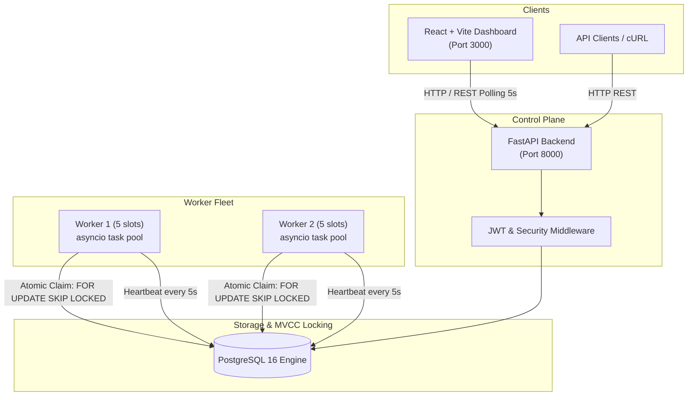

# Distributed Job Scheduler

A production-inspired, full-stack Distributed Job Scheduling Platform built with **FastAPI**, **SQLAlchemy 2.x**, **PostgreSQL**, **asyncio worker daemons**, and a responsive **React + TypeScript + Tailwind CSS** dashboard.

Featuring **atomic job claiming with PostgreSQL row-level locking (`FOR UPDATE SKIP LOCKED`)**, configurable retry policies, Dead Letter Queue (DLQ), worker heartbeats with automatic stale node eviction, and graceful task draining.

---

## Key Features

- **Atomic Job Claiming**: Leverages PostgreSQL `SELECT ... FOR UPDATE SKIP LOCKED` inside transactions to guarantee **zero double-claims** across multiple concurrent workers.
- **Configurable Retry Policies**: Supports `fixed`, `linear`, and `exponential` backoff strategies with configurable multipliers and maximum attempt thresholds.
- **Dead Letter Queue (DLQ)**: Automatically isolates permanently failed jobs, preserving diagnostic stack traces and supporting manual one-click requeuing.
- **Worker Heartbeat & Fleet Telemetry**: Distributed worker instances emit heartbeats every 5s; crashed nodes are automatically marked `OFFLINE` after 15s of inactivity.
- **Concurrent `asyncio` Execution**: Workers process up to `WORKER_CONCURRENCY` jobs simultaneously using lightweight coroutine task pools.
- **Rich Scheduling Modes**:
  - **Immediate**: Process as soon as a worker slot is available.
  - **Delayed**: Delay execution by `delay_seconds`.
  - **Scheduled**: Execute at a specific future ISO-8601 UTC timestamp (`scheduled_at`).
  - **Recurring Cron**: Automated recurring execution driven by standard 5-part cron syntax (`cron_expression`).
  - **Batch Ingestion**: Atomically submit up to 100 jobs in a single API call.
  - **Idempotency Keys**: Protects against accidental duplicate submissions via `Idempotency-Key` headers.
- **Queue Controls**: Dynamically pause/resume queues, set concurrency limits, and prioritize queues.
- **Modern Dashboard**: React 18, Vite, TypeScript, Tailwind CSS, Recharts for real-time telemetry and metrics.
- **Automated Test Suite**: Pytest suite verifying auth, CRUD, lifecycle state machine, retries, and multi-worker race conditions.
- **Docker Compose Ready**: One-command startup with PostgreSQL, FastAPI backend, 2 concurrent worker replicas, and React frontend.

---

## Architecture



---

## Tech Stack

| Layer | Technologies |
| :--- | :--- |
| **Backend API** | Python 3.12+, FastAPI, SQLAlchemy 2.0 (Async), Alembic, Pydantic v2, PostgreSQL, JWT (python-jose), Bcrypt |
| **Worker Engine** | Python 3.12+, asyncio, SQLAlchemy 2.0, croniter |
| **Frontend** | React 18, Vite, TypeScript, React Router 6, Axios, Tailwind CSS, Lucide React, Recharts |
| **Infrastructure** | Docker, Docker Compose, PostgreSQL 16 Alpine, Nginx |

---

## Project Structure

```
distributed-job-scheduler/
├── backend/
│   ├── app/
│   │   ├── main.py                     # FastAPI app, lifespan, CORS, global error handling
│   │   ├── config.py                   # Pydantic Settings
│   │   ├── database.py                 # Async SQLAlchemy engine & sessionmaker
│   │   ├── models/                     # SQLAlchemy 2.0 relational models (13 tables)
│   │   ├── schemas/                    # Pydantic validation & response schemas
│   │   ├── routers/                    # REST API route handlers
│   │   ├── services/                   # Business logic (Job, Queue, Worker, Auth, Metrics)
│   │   ├── middleware/                 # Uniform error envelope middleware
│   │   └── utils/                      # Security (JWT/bcrypt) & Pagination helpers
│   ├── alembic/                        # Async database migration scripts
│   ├── tests/                          # Automated Pytest suite (Auth, CRUD, Concurrency)
│   ├── seed.py                         # Realistic demo database seeder
│   ├── requirements.txt
│   └── Dockerfile
├── worker/
│   ├── worker.py                       # Main worker daemon, poll loop, scheduler, shutdown
│   ├── executor.py                     # Modular JobExecutor hierarchy (5 handlers)
│   ├── heartbeat.py                    # Worker heartbeat service & stale detector
│   ├── requirements.txt
│   └── Dockerfile
├── frontend/
│   ├── src/
│   │   ├── components/                 # Reusable UI (StatusBadge, Modals, Navbar, Layout)
│   │   ├── pages/                      # Dashboard, Queues, QueueDetails, JobExplorer, JobDetails, Workers, Metrics, Login
│   │   ├── services/                   # Axios API client
│   │   ├── hooks/                      # useAuth, usePolling
│   │   └── types/                      # TypeScript interfaces
│   ├── package.json
│   └── Dockerfile
├── docs/
│   ├── architecture.md                 # Architecture diagrams & sequence flows
│   ├── database.md                     # Database schema & Mermaid ER diagram
│   ├── api.md                          # REST API specification
│   └── design-decisions.md             # Concurrency & design decisions documentation
├── docker-compose.yml
├── .env.example
└── README.md
```

---

## Quickstart with Docker Compose

To build and run the entire distributed platform with **PostgreSQL**, **FastAPI Backend**, **2 Worker Instances**, and the **React Dashboard**:

```bash
# 1. Clone repository & copy environment variables
cp .env.example .env

# 2. Build and start containers
docker compose up --build
```

Access the services:
- **React Dashboard**: `http://localhost:3000`
- **FastAPI OpenAPI Swagger**: `http://localhost:8000/docs`
- **PostgreSQL Database**: `localhost:5432`

Default Demo Credentials:
- **Email**: `admin@example.com`
- **Password**: `password123`

---

## Local Development Setup

### 1. Backend Setup

```bash
cd backend

# Create virtual environment
python -m venv venv
source venv/bin/activate  # On Windows: venv\Scripts\activate

# Install dependencies
pip install -r requirements.txt

# Run migrations & seed data
alembic upgrade head
python seed.py

# Start API server
uvicorn app.main:app --reload --port 8000
```

### 2. Worker Setup

```bash
cd worker

# In the same virtual environment
export PYTHONPATH="../backend:."
python worker.py
```

### 3. Frontend Setup

```bash
cd frontend

# Install packages
npm install

# Start Vite development server
npm run dev
```

---

## Automated Testing

Run the full Pytest test suite:

```bash
python -m pytest -v backend/tests
```

### Concurrency Race Condition Test
The test suite includes `test_concurrency_atomic_claim.py`, which launches multiple concurrent workers competing for the same queue simultaneously to verify that **zero duplicate claims** occur and all jobs transition safely to `CLAIMED` status.

---

## Example API Requests

### 1. Authenticate
```bash
curl -X POST http://localhost:8000/auth/login \
  -H "Content-Type: application/json" \
  -d '{"email": "admin@example.com", "password": "password123"}'
```

### 2. Enqueue an Immediate Job
```bash
curl -X POST http://localhost:8000/queues/<QUEUE_ID>/jobs \
  -H "Authorization: Bearer <TOKEN>" \
  -H "Content-Type: application/json" \
  -d '{
    "job_type": "email_simulation",
    "payload": { "to": "user@example.com", "subject": "Hello" },
    "priority": 10
  }'
```

### 3. Enqueue a Delayed Job
```bash
curl -X POST http://localhost:8000/queues/<QUEUE_ID>/jobs \
  -H "Authorization: Bearer <TOKEN>" \
  -H "Content-Type: application/json" \
  -d '{
    "job_type": "sleep",
    "payload": { "seconds": 5 },
    "delay_seconds": 30
  }'
```

### 4. Enqueue Batch Jobs
```bash
curl -X POST http://localhost:8000/queues/<QUEUE_ID>/jobs/batch \
  -H "Authorization: Bearer <TOKEN>" \
  -H "Content-Type: application/json" \
  -d '{
    "jobs": [
      { "job_type": "echo", "payload": { "task": 1 } },
      { "job_type": "echo", "payload": { "task": 2 } },
      { "job_type": "calculation", "payload": { "operation": "fibonacci", "n": 30 } }
    ]
  }'
```

### 5. Requeue a Dead Letter Job
```bash
curl -X POST http://localhost:8000/jobs/<JOB_ID>/retry \
  -H "Authorization: Bearer <TOKEN>"
```

---

## Documentation

- [Architecture Specification](docs/architecture.md)
- [Database Schema & ER Diagram](docs/database.md)
- [REST API Reference](docs/api.md)
- [Design Decisions & Concurrency Analysis](docs/design-decisions.md)
