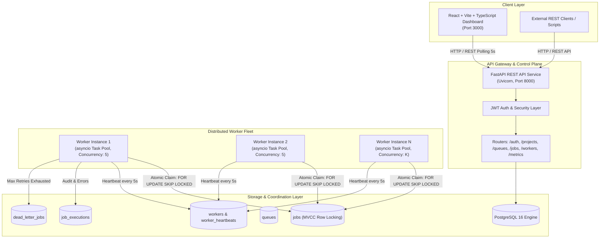
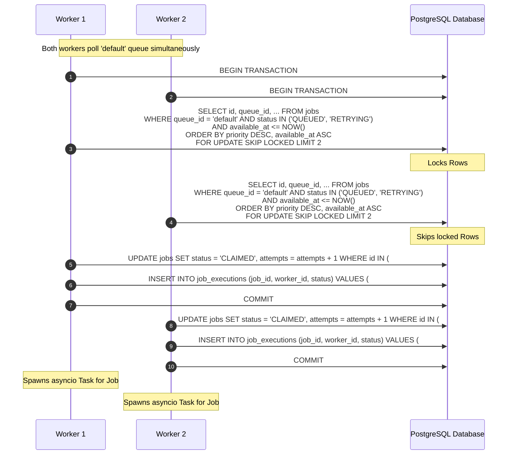
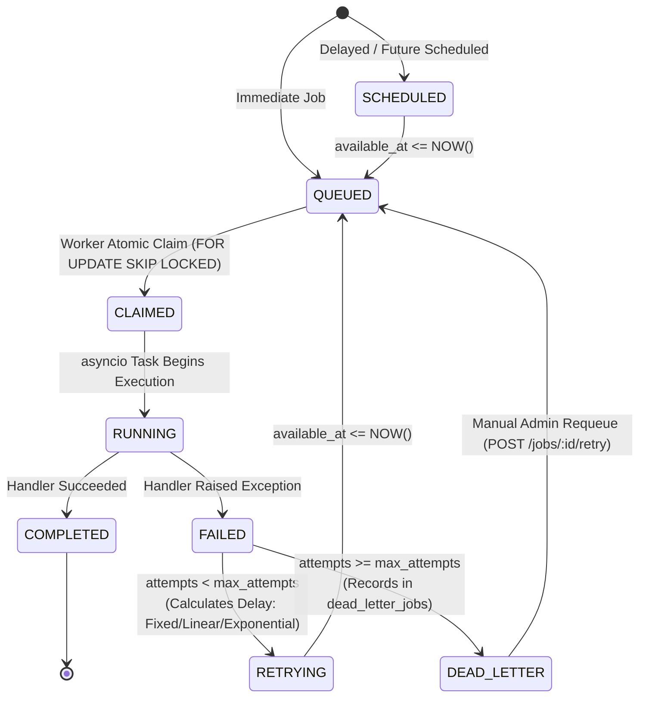

# Distributed Job Scheduler - Architecture Specification

This document details the high-level architecture, subsystem interactions, atomic job claiming protocol, worker task pool management, retry lifecycle, and Dead Letter Queue (DLQ) mechanics.

---

## 1. System Overview

---

## 2. Atomic Job Claiming Sequence

Multiple worker instances concurrently poll non-paused queues. The database transaction guarantees that **no two workers can ever claim the same job**.

---

## 3. Complete Job State Machine

---

## 4. Subsystem Responsibilities

### 1. API Control Plane (FastAPI)
- **Authentication**: JWT token issuance and validation, bcrypt password hashing.
- **Queue Administration**: Concurrency limits, priority hierarchy, pause/resume switches.
- **Job Ingestion**: Immediate, delayed, cron recurring, batch ingestion with idempotency checking.
- **Telemetry Aggregation**: Queue metrics, execution latencies, worker health status.

### 2. Distributed Worker Service (asyncio Daemon)
- **Self-Registration**: Registers worker metadata (hostname, PID, concurrency) on startup.
- **Heartbeat Loop**: Emits heartbeat every 5s recording active coroutines and remaining slots.
- **Queue Polling & Concurrency Protection**: Computes available worker capacity and respects per-queue limits before claiming.
- **Job Execution Abstraction**: Routes job payloads to dedicated `JobExecutor` implementations (`echo`, `sleep`, `calculation`, `email_simulation`, `intentional_failure`).
- **Dead Letter Escalation**: Automatically routes exhausted jobs to DLQ upon retry limit exhaustion.
- **Graceful Shutdown**: Intercepts `SIGINT`/`SIGTERM`, stops polling, drains running tasks, sets status to `STOPPING` then `OFFLINE`.

### 3. Recurring Cron Scheduler
- Periodically checks `scheduled_jobs` table for active cron expressions whose `next_run_at <= NOW()`.
- Enqueues fresh `Job` instances into the target queue and computes next execution timestamp via `croniter`.
