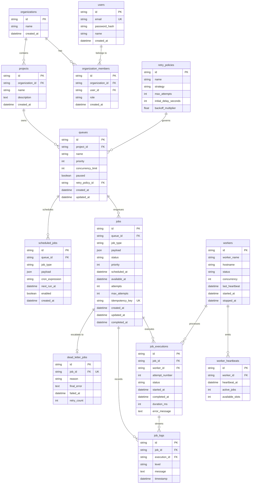

# Distributed Job Scheduler - Database Schema & ER Model

This document outlines the relational database architecture, Entity Relationship (ER) diagram, primary/foreign key constraints, cascade rules, and query optimization indexing strategies.

---

## 1. Entity Relationship (ER) Diagram



---

## 2. Table Specifications & Foreign Key Cascades

| Table | Target FK | On Delete Behavior | Rationale |
| :--- | :--- | :--- | :--- |
| `organization_members` | `organizations(id)`, `users(id)` | `CASCADE` | Deleting a user or organization purges membership mappings. |
| `projects` | `organizations(id)` | `CASCADE` | Deleting an organization deletes associated projects. |
| `queues` | `projects(id)` | `CASCADE` | Deleting a project purges its queues. |
| `queues` | `retry_policies(id)` | `SET NULL` | Deleting a retry policy sets queue policy to null without deleting queues. |
| `jobs` | `queues(id)` | `CASCADE` | Deleting a queue deletes all queued/completed jobs in it. |
| `job_executions` | `jobs(id)` | `CASCADE` | Deleting a job removes execution records. |
| `job_executions` | `workers(id)` | `SET NULL` | Terminating or deleting a worker preserves execution audit records. |
| `job_logs` | `jobs(id)` | `CASCADE` | Deleting a job cleans up log traces. |
| `dead_letter_jobs` | `jobs(id)` | `CASCADE` | Requeuing or removing a job purges DLQ entries. |
| `worker_heartbeats` | `workers(id)` | `CASCADE` | Purging worker removes historical heartbeats. |

---

## 3. Query Optimization Indexes

```sql
-- 1. Atomic claiming query optimization
CREATE INDEX idx_jobs_queue_priority_available ON jobs(queue_id, priority DESC, available_at ASC);

-- 2. Status & availability lookups for queue poller
CREATE INDEX idx_jobs_queue_status ON jobs(queue_id, status);
CREATE INDEX idx_jobs_status_available ON jobs(status, available_at);

-- 3. Execution history lookups
CREATE INDEX idx_job_executions_job_id ON job_executions(job_id);

-- 4. Job log time-series ordering
CREATE INDEX idx_job_logs_job_timestamp ON job_logs(job_id, timestamp);

-- 5. Worker heartbeat freshness lookups
CREATE INDEX idx_worker_heartbeats_worker_time ON worker_heartbeats(worker_id, heartbeat_at DESC);

-- 6. Recurring cron lookups
CREATE INDEX idx_scheduled_jobs_next_run ON scheduled_jobs(next_run_at);

-- 7. Unique constraints
CREATE UNIQUE INDEX idx_queues_project_name ON queues(project_id, name);
CREATE UNIQUE INDEX idx_jobs_idempotency ON jobs(idempotency_key) WHERE idempotency_key IS NOT NULL;
```
